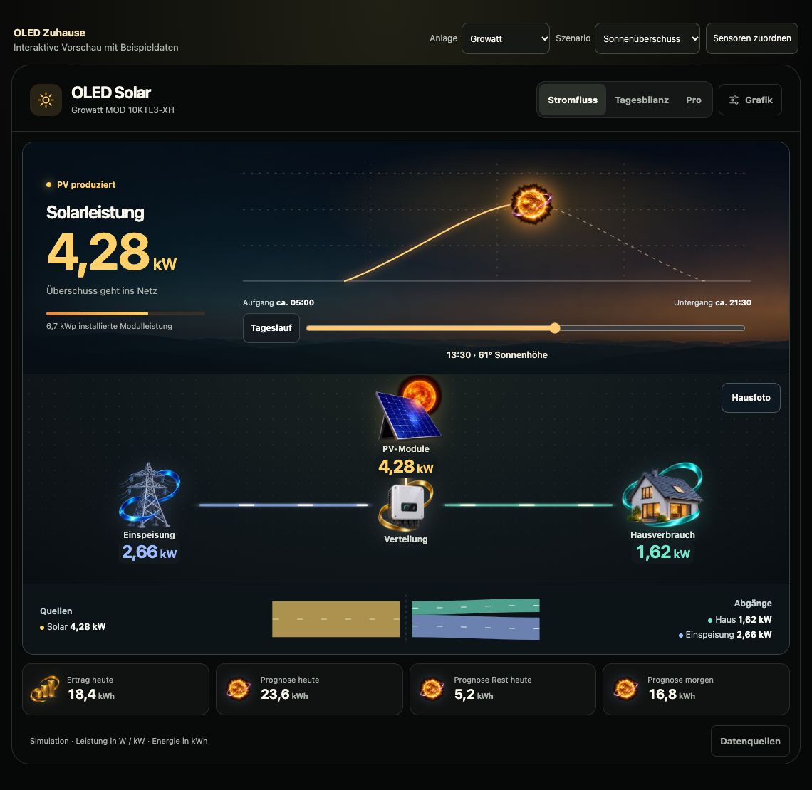

# OLED Solar für Home Assistant

Animierte Photovoltaik-Karte mit Sonnenbahn, Gerätemotiven und Live-Stromfluss. Die Karte arbeitet mit Sensoren aus Home Assistant und lässt sich im Karteneditor auf die eigene Anlage einstellen.



- **Kompakt** zeigt die Solarleistung, den Stromfluss und die Tageswerte.
- **Pro** ergänzt die animierte Sonnenbahn, Tarife, Vergleiche zum Vorjahr, PDF-Druck und den kostenlosen SFV-Regionalvergleich für Deutschland.
- **Hausfoto** legt ein eigenes Bild hinter den Stromfluss. Bildausschnitt und Abdunklung lassen sich einstellen.

[Handyansicht](docs/hybrid-handy.png) · [Pro-Auswertung](docs/auswertung.png)

## Installation

### Über HACS oder den Home-Assistant-Marktplatz

1. Öffne **Einstellungen → Marketplace → Über Link hinzufügen**. In älteren Home-Assistant-Versionen öffne **HACS → ⋮ → Benutzerdefinierte Repositorys** und wähle die Kategorie **Dashboard**.
2. Füge `https://github.com/Heinz-Creator/oled-solar-card` hinzu. Der Marketplace erkennt den Typ **Dashboard** automatisch.
3. Installiere **OLED Solar** und lade die Dashboard-Seite neu. Füge die Karte **OLED Solar** hinzu und wähle mindestens deinen PV-Leistungssensor aus.

Wenn du deine Dashboard-Ressourcen über YAML verwaltest, übernimm die Modul-URL aus dem Installationsdialog. Wenn du OLED Solar schon als manuelle Dashboard-Ressource eingebunden hast, entferne deren alten Ressourceneintrag nach der Installation, damit Home Assistant das Modul nur einmal lädt.

### Manuell installieren

1. Lade [dist/oled-solar-card.js](dist/oled-solar-card.js) über **Download raw file** herunter und kopiere die Datei in den Home-Assistant-Ordner `www`.
2. Registriere unter **Einstellungen → Dashboards → Ressourcen** die URL `/local/oled-solar-card.js` als **JavaScript-Modul**. Falls der Menüpunkt fehlt, aktiviere den erweiterten Modus im Benutzerprofil.
3. Füge im Dashboard eine Karte **OLED Solar** hinzu. Wähle im visuellen Editor mindestens einen PV-Leistungssensor aus. Für die manuelle Einrichtung stehen Vorlagen für [Kompakt](examples/kompakt.yaml) und [Pro](examples/pro.yaml) bereit.

Die Beispiele verwenden Platzhalter. Ersetze die Entitäts-IDs durch deine Sensoren. Leistungssensoren können W, kW oder MW liefern. Energiezähler können Wh, kWh oder MWh liefern. Speicher, Netz und Wallbox sind optional. Für den Vorjahresvergleich braucht Pro die Langzeitstatistik aus dem HA-Energiedashboard oder eigene Statistik-IDs unter `statistics`.

## Regionaler Ertragsvergleich

Die Karte vergleicht den Ertrag deiner Anlage in **kWh pro installiertem kWp** mit gemeldeten Erträgen aus der [kostenlosen SFV-Ertragsdatenbank](https://www.sfv.de/tools/ertragsdatenbank). Die Anlagen können unterschiedlich groß sein. Beim verwendeten Durchschnitt fallen leistungsstärkere Anlagen stärker ins Gewicht. Dachneigung, Ausrichtung und Verschattung können abweichen.

Mit Ort oder PLZ findest du die zweistellige PLZ-Region. Mit **PLZ von / bis** lässt sich der fünfstellige Bereich für abgeschlossene Jahre eingrenzen. Wähle für ein älteres Jahr den Zeitraum **Jahr** und das gewünschte Jahr aus. Bei einem Tages- oder Monatsbericht zeigt die Karte im Von-bis-Vergleich das letzte abgeschlossene Jahr.

## Eigenes Hausfoto

Öffne **Hausfoto** in der animierten Ansicht. Ein dort gewähltes Foto speichert der Browser lokal. Für mehrere Geräte kann die Karte ein Foto aus dem HA-Ordner `www` verwenden. Trage dessen Adresse im Karteneditor unter **Hausfoto für alle Geräte** ein, etwa `/local/mein-haus.webp`.

## Browser-Vorschau

Lade [OLED-Solar-Vorschau.html](OLED-Solar-Vorschau.html) herunter und öffne die Datei im Browser. Die Vorschau verwendet simulierte Messwerte. Du kannst Anlage und Betriebsszenario wechseln, Sensoren zuordnen und ein eigenes Hausfoto ausprobieren.

## Entwicklung

Mit Node.js 22 oder neuer ausführen.

```sh
npm ci
npm run build
```

Der Build erzeugt die fertige Karte und die eigenständige HTML-Vorschau. Hinweise zu eingebundenen Quellen stehen in [NOTICE.md](NOTICE.md).
